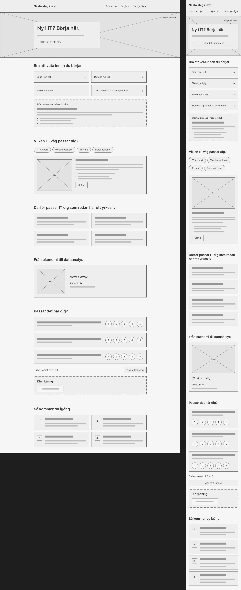

# Nästa steg i livet

## Om sidan

Sidan handlar om karriärbyte till IT i vuxen ålder och hur man får ihop det med familj och jobb. Den riktar sig till vuxna, till exempel föräldrar, som är nya i IT och undrar vilka yrken som finns, hur lång tid utbildningarna tar, vad de kostar och vilket stöd man kan få från Arbetsförmedlingen och CSN. Berättelsen om Anna på sidan är ett påhittat exempel och är märkt så.

## Skiss

Skissen är en wireframe i gråskala som jag tog fram i Figma med hjälp av Figmas AI-funktion. Bilden visar både desktop (till vänster) och mobil (till höger): [skiss/skiss.png](skiss/skiss.png).

Den färdiga sidan följer skissens upplägg och ordning, men några saker skiljer sig:

- **Sidhuvud:** skissen har ett enkelt sidhuvud med logga och meny. På den färdiga sidan är sidhuvudet svart med en gul prick framför loggan.
- **Hero:** i skissen ligger texten i en ruta ovanpå bakgrundsbilden. På den färdiga sidan ligger texten direkt på en mörkare bild, utan ruta, så att den blir lättare att läsa.
- **Snabbfakta:** skissen visar fyra breda rader med ett plustecken, två och två på desktop och under varandra på mobil. På den färdiga sidan är det fyra mörka kort med en kort undertext, två och två på större skärmar och under varandra på mobil. Informationspanelen öppnas under korten, som i skissen.
- **Passar det här dig?:** skissen har tre påståenden med skalan till höger på desktop och under påståendet på mobil. Den färdiga sidan har fem påståenden med skalan under varje påstående på alla skärmstorlekar, eftersom det fungerar bättre på en smal mobilskärm. Knappen "Visa mitt förslag" ligger under räknaren i stället för till höger.
- **Så kommer du igång:** i skissen ligger siffrorna i små rutor. På den färdiga sidan är det vanlig numrering i listan.
- **Vanliga frågor och sidfot:** de finns inte med i skissen, men de finns på den färdiga sidan.
- **Mobil:** mobilskissen lägger allt i en kolumn. På den färdiga sidan gäller samma upplägg i grundreglerna, och en media query (`min-width: 700px`) lägger kort, bilder och text bredvid varandra på större skärmar.
- **Färger och bilder:** skissen är i gråskala med platshållare. Färger (svart och gult), bilder och exakta texter bestämdes under bygget.

## Funktionalitet

Besökaren kan göra fyra saker. All logik finns i `js/script.js`, och alla funktioner kopplas med `addEventListener`.

- **Klicka på ett snabbfakta-kort** och få information om att byta yrke som vuxen, flexibilitet, kostnad och stöd. Ett nytt klick på samma kort stänger panelen. Funktioner: `handleFactClick`, `closeFacts`.
- **Välja en IT-roll** och se beskrivning, tid till första jobb, om rollen passar familjelivet och ett bra första steg. Funktioner: `handleRoleClick`, `showRole`, `hideRole`, `markActiveButton`, `clearActiveButtons`. Texterna ligger i objektet `roles`.
- **Öppna och stänga vanliga frågor**, där bara en fråga är öppen i taget. Funktioner: `toggleAnswer`, `setAnswerState`.
- **Svara på fem påståenden på en skala 1–5** och få förslag på IT-riktning. Funktioner: `handleScaleChange`, `countAnswered`, `getSuggestedRoles`, `showSuggestion`, `handleSuggestionClick`, `joinWithEller`, `resetSuggestion`.

Filer: `index.html` (struktur), `css/style.css` (utseende och responsivitet), `js/script.js` (interaktivitet).

## AI-användning

### Exempel 1: klickbara snabbfakta-kort

- Vad bad jag om? Att göra korten med snabbfakta klickbara så att information visas när man klickar. Innehållet skulle handla om att det aldrig är för sent att byta yrke som vuxen, om att få ihop det med familjen, om kurser som tar 8 månader till 2 år och om stöd från Arbetsförmedlingen och CSN.
- Vad fick jag? HTML med knappar och en informationspanel, CSS för panelen och JavaScript med `handleFactClick` och `closeFacts`.
- Vad gjorde jag med det? Jag ändrade rubriker och undertexter, lade till ett fjärde kort om kostnad och tog bort en rubrik som upprepade kortets titel. Jag har testat att kortet öppnas, byter och stängs.

### Exempel 2: text om kostnad och stöd

- Vad bad jag om? Att texten skulle säga att kurserna är gratis och betalas av regeringen.
- Vad fick jag? En formulering som begränsar gratis utbildning till yrkeshögskola, komvux och folkhögskola, med en notis om att privata kurser kan kosta pengar. Uppgifterna om CSN och Arbetsförmedlingen kom från en sökning.
- Vad gjorde jag med det? Jag behöll begränsningen, eftersom "alla kurser är gratis" inte stämmer. Jag lade till länkar till csn.se och arbetsformedlingen.se och en notis om att reglerna ändras. Jag bytte också "staten och regeringen" mot "staten eller kommunen", eftersom komvux drivs av kommunerna.

### Exempel 3: kontroll mot kursens krav

- Vad bad jag om? Att anpassa projektet efter uppgiftens krav.
- Vad fick jag? En validering med W3C:s validator som hittade två fel: ett `figcaption` som låg i en `div` och en rubrik som hoppade från `h1` till `h3`. Dessutom en omstädad CSS och en JavaScript-fil utan upprepad kod.
- Vad gjorde jag med det? Jag rättade båda felen, och sidan validerar nu utan fel.

### Exempel 4: skiss

- Vad bad jag om? Att Figmas AI skulle skapa en wireframe i gråskala över sidans upplägg. Jag beskrev varje sektion och bad om gråa rutor i stället för bilder och text.
- Vad fick jag? En wireframe med både desktop- och mobilversion och alla sektioner utom vanliga frågor och sidfot.
- Vad gjorde jag med det? Jag exporterade den som PNG, lade den i mappen `skiss/` och jämförde den med den färdiga sidan. Skillnaderna står under rubriken Skiss.

## Bildkällor

Bilderna kommer från sidorna nedan och används bara i den här skoluppgiften. Rättigheterna tillhör respektive upphovsperson.

- **`hero.jpg`:** AI-genererad med ChatGPT (OpenAI).
- **`web.jpg`:** [ER10.kz](https://er10.kz/read/it-novosti/vibe-coding-pomogaet-nebolshim-startapam-uspeha/)
- **`test.jpg`:** [IECA](https://www.iecaonline.com/blog/introducing-the-axs-companion-to-common-app/)
- **`support.jpg`:** Adobe Stock, gratis samling, bild-ID 740166970 ([stock.adobe.com](https://stock.adobe.com/))
- **`story.jpg`:** [Coursera, kursbild](https://s3.amazonaws.com/coursera-course-photos/0d/1f72a872ec4bef995ec1c867f5e8b9/1200x1200_247177471.jpg)
- **`data.jpg`:** [Clootrack](https://www.clootrack.com/blogs/customer-centric-product-development-harnessing-feedback-for-better-strategy)

## Tekniska val (VG)

- **Data i ett objekt.** Rollernas texter ligger i `roles` i `js/script.js`, så att funktionerna inte behöver ändras när texten ändras.
- **Mappstruktur.** `index.html` ligger i roten, och CSS (`css/`), JavaScript (`js/`), bilder (`bilder/`) och skiss (`skiss/`) ligger i egna mappar, så att varje filtyp hittas på ett ställe.
- **`<button>` för klickbara kort.** Knappar fungerar med tangentbord, och `aria-expanded` visar för skärmläsare om panelen är öppen.
- **`hidden`-attributet** döljer och visar innehåll i stället för inline-stilar.
- **`data-*`-attribut** (`data-fact`, `data-role`) kopplar knappar till rätt innehåll, så en funktion kan hantera alla kort.
- **Samma namnkonvention överallt:** små bokstäver och bindestreck (kebab-case) för filer, klasser och id (`fact-panel`, `role-button`, `web.jpg`). Klasser och id är på engelska, mapparna (`bilder/`, `skiss/`) på svenska. Tillstånd heter `is-active`.
- **CSS-variabler** för färger, rundning och gradient, så att utseendet ändras på ett ställe.
- **Mobil först och en media query.** Grundreglerna gäller mobil. Media queryn `@media (min-width: 700px)` lägger kort, bild och text bredvid varandra när skärmen är minst 700 px bred. Utan den skulle allt ligga i en smal kolumn även på laptop.
- **Flexbox** används för all placering.

## Bedömning av AI-innehåll (VG)

**Hur avgjorde jag om det AI gav mig var bra nog?**
Jag jämförde det med uppgiftens krav och med vad som faktiskt stämmer. HTML kontrollerade jag med W3C:s validator, och den validerar utan fel. Uppgifter om stöd och kostnader jämförde jag med csn.se och arbetsformedlingen.se, eftersom reglerna har villkor och ändras.

**Vad behöll jag?**

- Funktionsindelningen i JavaScript, där varje funktion gör en sak.
- `<button>`-lösningen för klickbara kort och `aria-expanded`.
- CSS-variablerna.

**Vad ändrade jag, och varför?**

- **Texten om kostnad:** "alla kurser är gratis" stämmer inte. Den gäller nu bara utbildningar som staten eller kommunen finansierar, och en notis säger att privata kurser kan kosta pengar.
- **Omställningsstudiestödet:** jag jämförde texten med villkoren på csn.se (ålder 27–63, arbete minst 8 av de senaste 14 åren, utbildningen ska stärka ställningen på arbetsmarknaden, högst ca 2 år för den som är under 40) och skrev om den så att den stämmer.
- **Tidsangivelserna:** de ligger nu mellan 8 månader och 2 år.
- **En motsägelse:** en kurs var både "gratis" och "kostar lite". Jag skrev om meningen.
- **Berättelsen:** den är påhittad, så jag märkte den som exempel på sidan. Bildkällan finns under Bildkällor.
- **Det jag tog bort:** upprepade rubriker, regler i CSS som skrevs över längre ner i filen och kod som upprepades i JavaScript.
- **Bilder:** jag skrev ner var varje bild kommer ifrån under Bildkällor..